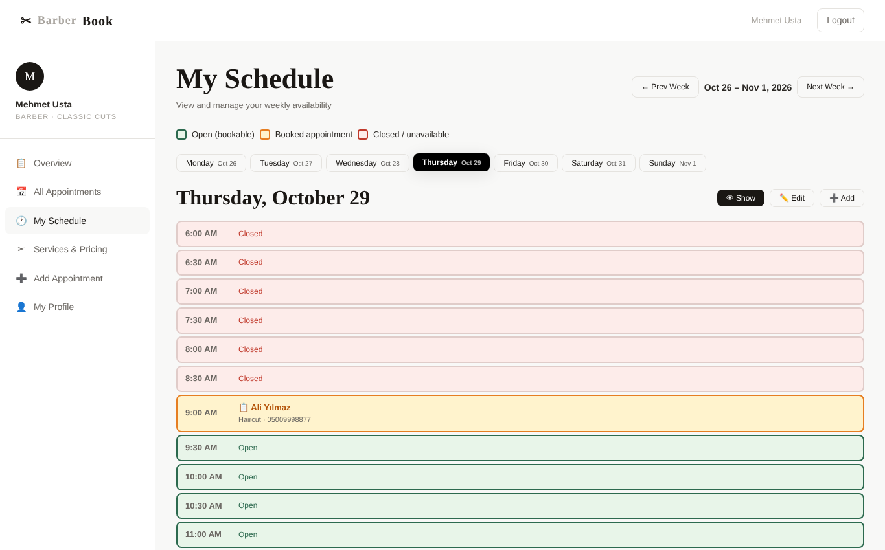
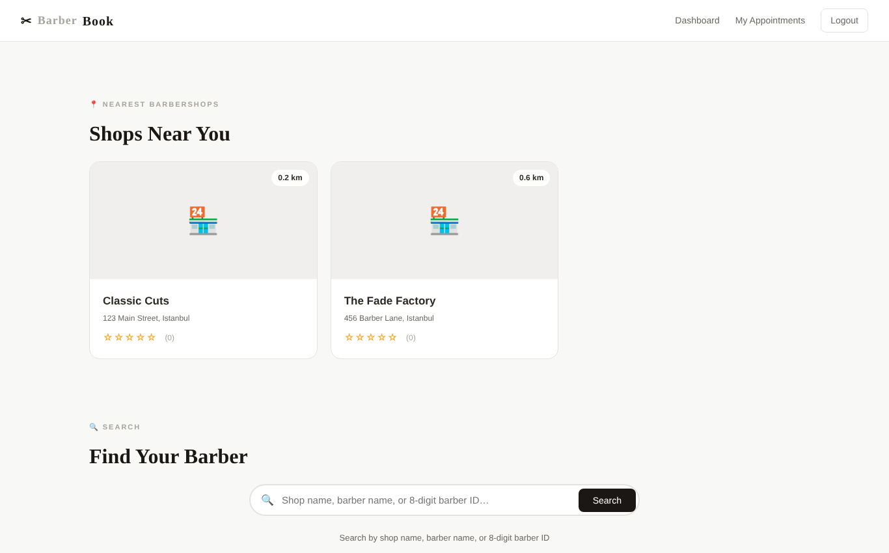
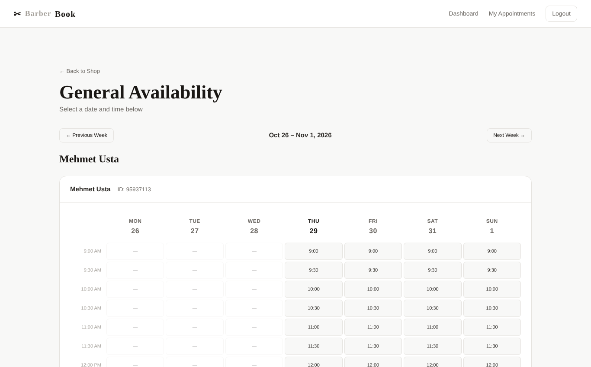
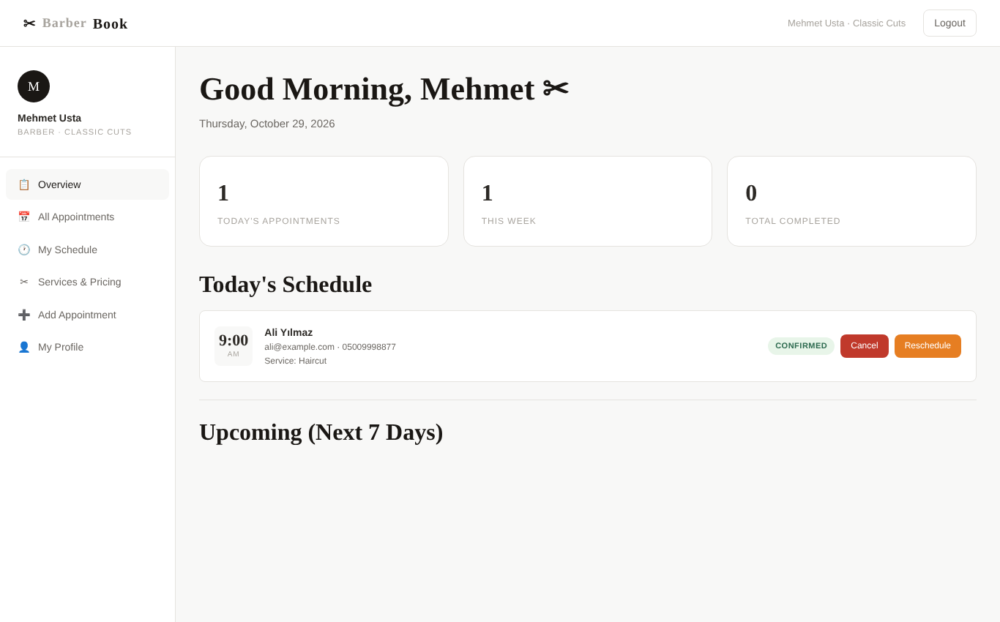
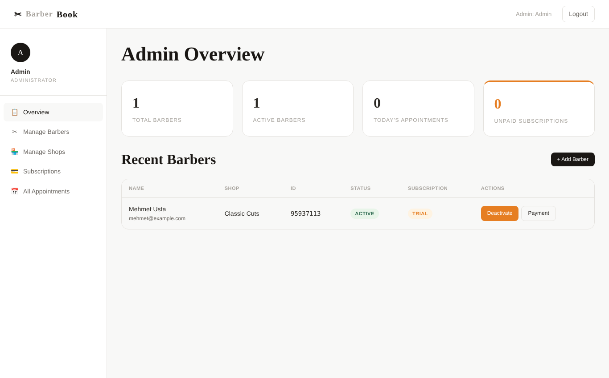

# Barbbey — Barber Appointment Booking Platform

A full-stack booking platform that connects barbershops with customers. Customers find nearby shops and book a time slot with a specific barber. Barbers manage their weekly schedule, services and appointments. An admin manages barbers, shops and monthly subscriptions.

Built end to end by me. *(Originally named BarberBook.)*



## Features

**Customers**
- Register, log in and reset a forgotten password by email
- "Shops near you" sorted by real distance from the customer's location (Haversine formula)
- Search by shop name, barber name, or a barber's 8-digit ID
- Two ways to book: a shop's combined availability, or one barber's weekly calendar
- See upcoming and past appointments; accept or decline reschedule requests from the email link

**Barbers**
- Dashboard with today's and upcoming appointments
- Weekly schedule grid: open, booked and closed slots, with modes to view, edit open hours, or add a walk-in appointment
- Services and pricing
- Cancel or reschedule appointments; the client gets an email to confirm the new time

**Admin**
- Create barber accounts (each gets a unique 8-digit barber ID), activate or deactivate them
- Manage shops and see all appointments
- Track monthly subscription payments per barber

**Under the hood**
- PDO prepared statements for every query (80+), protecting against SQL injection
- Passwords hashed with `password_hash` / `password_verify`
- Email notifications with PHPMailer over SMTP
- Mobile-friendly layout with a hamburger menu

## Screenshots

| Nearby shops | Booking calendar |
|---|---|
|  |  |
| **Barber dashboard** | **Admin dashboard** |
|  |  |

## Tech stack

PHP 8 · MySQL (PDO) · JavaScript (AJAX) · HTML/CSS · PHPMailer

## Run it locally

```bash
composer install                     # installs PHPMailer (only needed for emails)
mysql -u root < database.sql         # creates barbershop_db with an admin and two sample shops
php -S 127.0.0.1:8000
```

Open `http://127.0.0.1:8000`.

- **Admin:** `http://127.0.0.1:8000/admin/login.php`, email `admin@barbershop.com`, password `admin123`. Change it before deploying.
- Create a barber from **Admin → Manage Barbers**, then log in at `/barber/login.php`.
- Register as a customer at `/register.php`.

### Configuration

Settings are read from environment variables, with local defaults:

| Variable | Default |
|---|---|
| `DB_HOST` / `DB_PORT` | `127.0.0.1` / `3306` |
| `DB_USER` / `DB_PASS` | `root` / *(empty)* |
| `DB_NAME` | `barbershop_db` |
| `SITE_URL` | `http://127.0.0.1:8000` |
| `MAIL_USER` / `MAIL_PASS` / `MAIL_FROM` | Gmail address and app password for SMTP |

## Project structure

```
├── login.php · register.php · forgot-password.php · reset-password.php
├── shop.php · book.php · reschedule_response.php
├── client/      # Customer dashboard and appointments
├── barber/      # Barber dashboard, schedule, services, profile, walk-in booking
├── admin/       # Barbers, shops, subscriptions, appointments
├── api/         # Search endpoint (AJAX)
├── includes/    # Config, DB connection, mailer, layout
├── css/ · js/
└── database.sql
```
